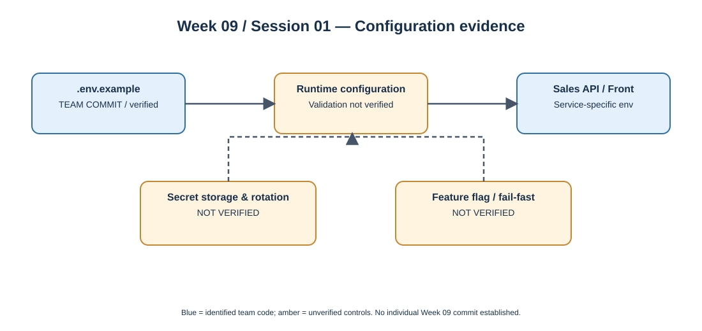

# Week 09 — Session 01

## Configuration, secrets and feature flags — OptiView evidence review

**Moodle objective:** Externalize configuration following twelve-factor principles; avoid committing secrets; validate startup configuration; use feature flags to separate deployment from release.

**Nature of this artifact:** Retrospective technical review prepared on 2026-10-11. This file does not assert that all Week 09 practices were implemented or deployed.

## 1. Configuration by environment

OptiView services are designed to read environment-dependent values externally instead of hardcoding credentials. The team commit [b645936](https://github.com/code-corhuila/opti-sales-api/commit/b6459369816be632426e3139cd5fc543dd94d5a9) added `opti-sales-api/.env.example`, a CI workflow and PR template. The example enumerates database name, database user, a password placeholder, a JWT public-key placeholder, and optional integration-test configuration. The file is a **template**, not evidence that a secret manager has been deployed.

The team commit [84ca613](https://github.com/code-corhuila/opti-front/commit/84ca613ee4d361046b80e6640c1adfabbdd753b5) added `opti-front/.env.example` with `GATEWAY_PUBLIC_URL`, plus CI configuration. This establishes a concrete difference between internal service addresses and the public browser-facing gateway URL.

These commits were authored by another team member, not by Julian Vargas; they are **project context**, not an individual contribution claim.

## 2. Secrets and minimum privilege

The Moodle session specifies: never place real secrets in Git, images or logs; inject them at runtime; document ownership and rotation. In this retrospective review we can confirm the presence of example variables but **cannot verify** actual secret-store provisioning, secret-rotation schedules or a repository-wide secrets scan from the two cited commits.

## 3. Fail-fast startup validation

A required variable must be checked when the service starts, and invalid configuration must stop startup with a clear error. This is the target behavior from the session. Verification against executable startup code and tests is still pending; `*.env.example` alone is not proof of fail-fast validation.

## 4. Feature flags

The session requires at least one feature guarded by a flag. A candidate for a future release policy is `reports.enabled`, defaulting to `false` in production until QA passes. **This is a proposed flag, not a verified OptiView implementation.** It must not be marked as deployed without a corresponding code change and test.

## 5. Diagram and traceability

- Team context: [Sales API configuration and CI](https://github.com/code-corhuila/opti-sales-api/commit/b6459369816be632426e3139cd5fc543dd94d5a9); [Front configuration and CI](https://github.com/code-corhuila/opti-front/commit/84ca613ee4d361046b80e6640c1adfabbdd753b5).
- Moodle: Week 09, Session 01, "Configuration, secrets and feature flags", sections 1–4 and "This week".
- Individual development evidence for Week 09: **not verified**. This new documentation is retrospective and should only be linked to a new, real commit if published.

## 6. Verification checklist

- [x] Repository examples and CI changes identified and attributed to their recorded authors.
- [ ] Actual runtime secret store and rotation verified.
- [ ] Fail-fast startup behavior verified with a test.
- [ ] Feature flag implemented and test evidence attached.
- [ ] Secret scanning in CI verified.
