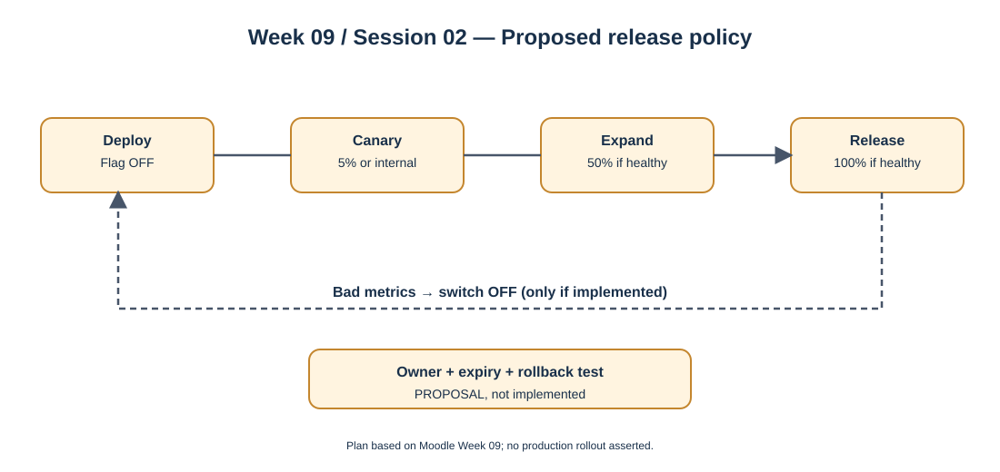

# Week 09 — Session 02

## Secure configuration and progressive delivery plan for MVP 2

**Moodle objective:** Document secret ownership and rotation, a temporary feature-flag strategy, canary rollout, instant rollback and two independently testable hardening stories.

**Evidence status:** This is a **proposal and retrospective planning artifact**, authored on 2026-10-11. No cited commit demonstrates that the following rollout or secret rotation already occurred.

## 1. Proposed ownership and rotation register

| Item | Proposed owner | Storage / injection | Access rule | Rotation / verification |
|---|---|---|---|---|
| Sales DB password | Sales/infra maintainer (confirm) | External secret store -> runtime environment | Only sales service and authorized DB admins | Define rotation cadence; document credential replacement and test |
| JWT signing or validation material | Identity/infra maintainer (confirm) | Managed key material / runtime injection as needed | Minimum privilege; only public verification material where applicable | Review key lifecycle and revoke compromised keys |
| Public gateway URL | Frontend/infra maintainer (confirm) | Nonsecret environment configuration | May be public | Validate per environment at deployment |

A `.env.example` is a variable inventory, **not** the secret store. Owners above are recommendations awaiting team confirmation.

## 2. Proposed feature-flag policy

- Example candidate: `reports.enabled`, guarded by runtime configuration, **not present as a verified implemented flag**.
- Define owner, rollout audience, creation date and removal deadline before merging.
- Default OFF when the feature is high-risk; enable for internal users or a limited cohort first.
- Remove the flag after stabilization to prevent flag debt.

## 3. Proposed progressive release

1. Deploy the same tested artifact with flag OFF.
2. Enable for internal QA or a 5% cohort only if the service supports audience targeting.
3. Observe authorization failures, 5xx error rate, latency and report-data correctness.
4. Increase to 50% and 100% only after passing defined thresholds.
5. On unacceptable metrics, disable the flag and investigate; **a flag rollback is possible only when the application actually implements such a flag**.

## 4. Proposed MVP 2 hardening stories

| Draft story | Acceptance criteria | Status |
|---|---|---|
| SEC-CONFIG-09 (proposal): validate required configuration on startup | Missing/invalid required value prevents readiness; test demonstrates fail-fast; no secret echoed in logs | `todo` — no implementation evidence |
| SEC-RELEASE-09 (proposal): safe rollout of reports | Feature flag default OFF; documented owner/removal date; QA rollout evidence; rollback test recorded | `todo` — no implementation evidence |

These are **proposed planning identifiers**, not registered project backlog HU IDs.

## 5. Project references and limits

- [Sales API CI and variable template](https://github.com/code-corhuila/opti-sales-api/commit/b6459369816be632426e3139cd5fc543dd94d5a9) and [Frontend CI and variable template](https://github.com/code-corhuila/opti-front/commit/84ca613ee4d361046b80e6640c1adfabbdd753b5) provide supporting team context only.
- Moodle: Week 09, Session 02, sections "Secrets plan", "Feature-flag strategy", "Canary + rollback", and "This week".
- No Week 09 individual commit or implemented canary/rollback was identified. Do not present planning as a completed deployment.
