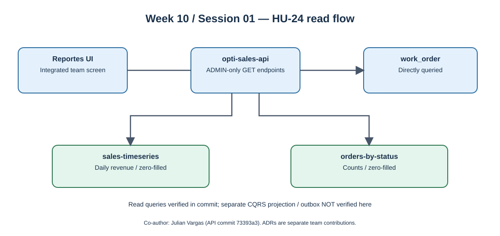

# Week 10 — Session 01

## Persistence, Saga, Outbox, CQRS — HU-24 reporting evidence

**Moodle objective:** Explain database-per-service, sagas and compensation, transactional outbox, read/write separation and eventual consistency.

**Individual evidence:** Julian Vargas is explicitly listed as `Co-authored-by` in the HU-24 Sales API commit [73393a3](https://github.com/code-corhuila/opti-sales-api/commit/73393a36913f0bdcd697cfea243757b99b39a03d), dated 2026-10-06. GitHub lists `BackSua` as the primary author. Co-authorship is visible in the commit message; the precise breakdown of code written by each coauthor is not available from Git history.

## 1. Verified HU-24 API changes

The commit adds two ADMIN-only endpoints to `ReportsController`:

- `GET /api/v1/reports/sales-timeseries`: daily revenue from the first day of the current UTC month through today; absent days are zero-filled.
- `GET /api/v1/reports/orders-by-status`: counts of work orders per status, with unused statuses zero-filled.

The endpoints query data derived from the service-owned `work_order` table. The commit changes nine files across HTTP adapter, JDBC persistence adapter, use-case interfaces/service, application configuration and tests (`ReportServiceTest`, fixtures and in-memory support). This is evidence of **reporting queries and test code added**, not of test execution successfully passing.

## 2. Relation to CQRS and service data ownership

The reporting endpoints are a clear **read path** separated at the HTTP/application boundary from order commands. However, the code described in the commit reads directly from `work_order`; it does **not** prove that an independently projected, eventually consistent read model exists. Do not claim complete CQRS implementation on the strength of HU-24 alone.

The team ADR-006 describes a CQRS-style reporting direction, while ADR-005 addresses outbox-style asynchronous effects: [team architecture decision commit](https://github.com/code-corhuila/opti-docs/commit/f1c04ffe0552032f087c0de43df1c49777c381a0). That commit is authored by another teammate and is **architectural context**, not individual HU-24 authorship evidence.

## 3. Sagas and outbox — not in this individual commit

Moodle also calls for compensating transactions, atomic outbox records and idempotent consumers. The inspected HU-24 report commit does not establish those behaviors. They require separate cross-service implementation, test and failure-injection evidence before completion can be claimed.

## 4. Diagram — actual read flow vs architectural extension

## 5. Traceable evidence

- **Individual co-authorship:** [HU-24 Sales API commit](https://github.com/code-corhuila/opti-sales-api/commit/73393a36913f0bdcd697cfea243757b99b39a03d).
- **Project architecture context (teammate commit):** [ADR-005 / ADR-006](https://github.com/code-corhuila/opti-docs/commit/f1c04ffe0552032f087c0de43df1c49777c381a0).
- Moodle: Week 10, Session 01, sections "Database per service", "Saga", "Outbox", "CQRS" and "This week".
- Execution of tests, a standalone read database, a working outbox and failure compensation: **not verified by the cited HU-24 commit**.
