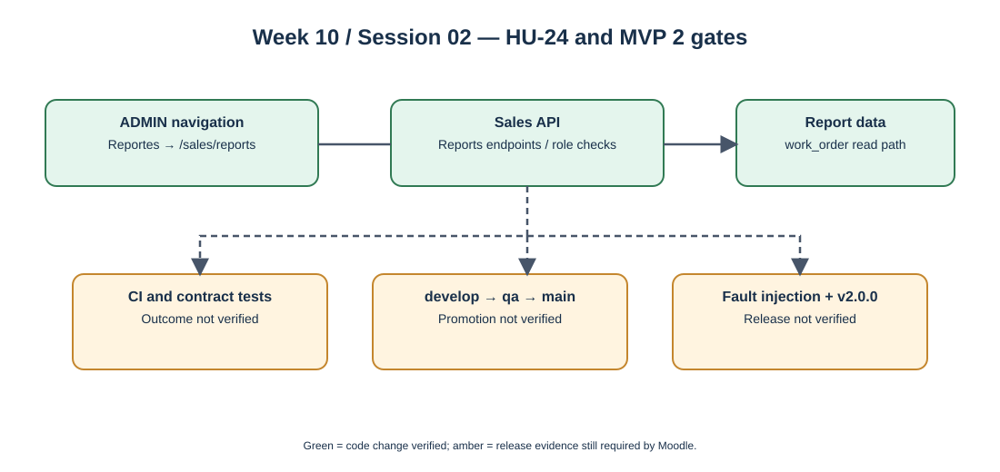

# Week 10 — Session 02

## MVP 2 integrated release — HU-24 navigation and release-readiness review

**Moodle objective:** Promote `develop → qa → main`, verify all committed stories and failure paths, tag release `v2.0.0`, demonstrate the integrated system and record a retrospective.

**Individual evidence:** Julian Vargas is listed as `Co-authored-by` on the frontend commit [bb7f498](https://github.com/code-corhuila/opti-front/commit/bb7f49877907d44fb2084331505c2149a530d159), dated 2026-10-06; GitHub lists `BackSua` as primary author. The change adds an ADMIN-only `Reportes` navigation entry pointing to `/sales/reports` in `src/remotes/registry.ts`.

## 1. Verified integration contribution

The navigation change connects authorized administrator users to the sales reports route. The related sales API commit [73393a3](https://github.com/code-corhuila/opti-sales-api/commit/73393a36913f0bdcd697cfea243757b99b39a03d) supplies two queries used by the wider reporting feature. The portal's reporting screen is a **team integration component**, not evidence of individual authorship from these two commits.

The role restriction in the frontend is user-interface navigation control. The backend independently performs ADMIN authorization for the two report endpoints; frontend hiding alone is not a security boundary.

## 2. MVP 2 release evidence matrix

| Moodle release requirement | Evidence currently available | Result |
|---|---|---|
| Front navigation and reporting API connected conceptually | [Frontend HU-24](https://github.com/code-corhuila/opti-front/commit/bb7f49877907d44fb2084331505c2149a530d159) + [Sales API HU-24](https://github.com/code-corhuila/opti-sales-api/commit/73393a36913f0bdcd697cfea243757b99b39a03d) | Code changes confirmed; end-to-end runtime demonstration not verified |
| Role-based access | ADMIN-only menu entry and `requireRole(..., ADMIN)` on report endpoints | Static code review evidence; authorization tests/runtime outcomes not verified |
| Unit / integration / contract tests green | Test files added in API commit | CI outcome not checked; do not mark green |
| `develop → qa → main` promotions | Moodle-defined target flow | Promotion chain not verified |
| `v2.0.0` tag, changelog, release image | Moodle-defined target artifacts | Not verified |
| Failure injection, saga compensation, outbox/idempotency | Required system-level demonstration | Not verified |

## 3. Diagram and recommended demonstration

Recommended demonstration (to be performed and recorded, not claimed as completed): sign in as ADMIN; access `/sales/reports`; inspect the returned values for both endpoints; verify that a non-ADMIN request is rejected by the API; capture CI results and QA promotion PRs; demonstrate a separate saga/outbox failure case with its compensation and durable event handling.

## 4. Retrospective and pending items

- **Keep:** commit-level traceability, explicit route/role definitions and application-layer reporting use cases.
- **Improve:** attach CI run links, contract test results and actual environment promotion PRs.
- **Carry to next cut if unfinished:** demonstrated fault recovery, release tag verification and per-service consistency checks.

## 5. Evidence links

- **Individual co-authorship:** [Frontend HU-24](https://github.com/code-corhuila/opti-front/commit/bb7f49877907d44fb2084331505c2149a530d159) and [Sales API HU-24](https://github.com/code-corhuila/opti-sales-api/commit/73393a36913f0bdcd697cfea243757b99b39a03d).
- **Context only:** [ADR-005 / ADR-006](https://github.com/code-corhuila/opti-docs/commit/f1c04ffe0552032f087c0de43df1c49777c381a0).
- Moodle: Week 10, Session 02, sections "Promote and tag", "MVP 2 DoD", "Demonstrate failures", "Retrospective" and "This cut".
