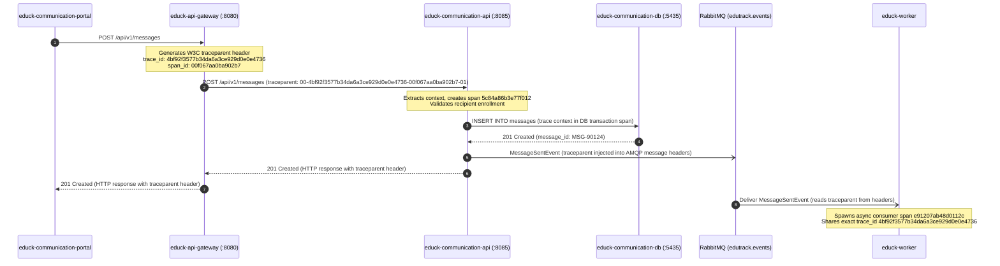

# Critical Journey and Distributed Trace Map - EduTrack

## 1. Critical User Journey Overview
- **Journey Name:** Parent-Teacher Secure Messaging Journey
- **Description:** A parent creates and sends an auditable, secure message to a course teacher through the portal shell. The journey traverses ingress routing, business invariant validation, transactional persistence in PostgreSQL, asynchronous event publication through RabbitMQ, and consumer worker processing for notifications.
- **Participating Components:**
  1. `educk-communication-portal` (Frontend Client SPA)
  2. `educk-api-gateway` (Reactive Spring Cloud Gateway, port :8080)
  3. `educk-communication-api` (Hexagonal Spring Boot 3 Core Service, port :8085)
  4. `educk-communication-db` (PostgreSQL 16 isolated database, port :5435)
  5. `RabbitMQ` (Message Broker, exchange `edutrack.events`, port :5672)
  6. `educk-worker` (Async event subscriber and deduplicator worker)

---

## 2. Distributed Hop Table

| Hop | Caller | Receiver | Protocol | Operation / Endpoint | Sync/Async | Data Exchanged |
|:---:|:---|:---|:---:|:---|:---:|:---|
| 1 | `educk-communication-portal` | `educk-api-gateway` | HTTP / REST | `POST /api/v1/messages` | Sync | JSON payload: senderId, recipientId, studentId, subject, body |
| 2 | `educk-api-gateway` | `educk-communication-api` | HTTP / REST | `POST /api/v1/messages` | Sync | Ingress payload + injected W3C `traceparent` header |
| 3 | `educk-communication-api` | `educk-communication-db` | TCP / Postgres | `INSERT INTO messages` | Sync | SQL parameters: message UUID, timestamps, thread reference |
| 4 | `educk-communication-api` | `RabbitMQ` | AMQP 0-9-1 | Publish `edutrack.events` | Async | `MessageSentEvent` JSON + `traceparent` in AMQP headers |
| 5 | `educk-worker` | `RabbitMQ` | AMQP 0-9-1 | Consume `educk.communication.notifications` | Async | Payload consumed; `traceparent` extracted from header |

---

## 3. Sequence Diagram with Trace Context Propagation

---

## 4. Distributed Span Tree Hierarchy

- **Root Span:** `educk-api-gateway: HTTP POST /api/v1/messages`
  - `trace_id`: `4bf92f3577b34da6a3ce929d0e0e4736`
  - `span_id`: `00f067aa0ba902b7`
  - `parent_span_id`: `null` (ingress root)
  - **Child Span 1:** `educk-communication-api: HTTP POST /api/v1/messages`
    - `trace_id`: `4bf92f3577b34da6a3ce929d0e0e4736`
    - `span_id`: `5c84a86b3e77f012`
    - `parent_span_id`: `00f067aa0ba902b7`
    - **Child Span 1.1:** `educk-communication-api: DB INSERT messages`
      - `trace_id`: `4bf92f3577b34da6a3ce929d0e0e4736`
      - `span_id`: `a182f4bc39e10d54`
      - `parent_span_id`: `5c84a86b3e77f012`
    - **Child Span 1.2:** `educk-communication-api: AMQP publish MessageSentEvent`
      - `trace_id`: `4bf92f3577b34da6a3ce929d0e0e4736`
      - `span_id`: `3d91ca82bb4560ea`
      - `parent_span_id`: `5c84a86b3e77f012`
  - **Child Span 2 (Asynchronous Boundary Crossing):** `educk-worker: AMQP consume MessageSentEvent`
    - `trace_id`: `4bf92f3577b34da6a3ce929d0e0e4736`
    - `span_id`: `e91207ab48d0112c`
    - `parent_span_id`: `3d91ca82bb4560ea` (propagated via AMQP header)
