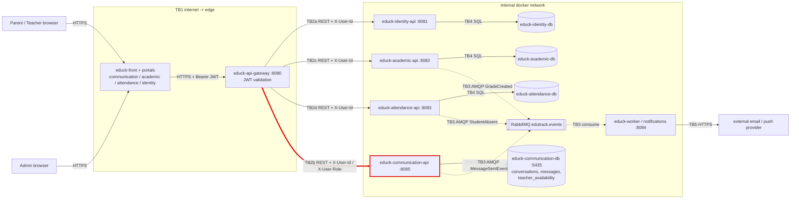

# CP1 - Attack Surface Map (EduTrack)

Sources: `05-architecture/overview.md`, `ADR-006-api-gateway-jwt.md`, `ADR-004-message-broker.md`, `07-api/contracts/openapi/communication-service.yaml` and `08-diagrams/diagrams/source/erd-communication.mmd` of `educk-docs`.

## 1. Data-flow diagram with trust boundaries

My boundary is **TB2b** (highlighted in red).

| ID | Trust boundary | Owner |
|---|---|---|
| TB1 | Internet -> portals / `educk-api-gateway` | team |
| TB2a-d | `educk-api-gateway` -> each backend API | TB2d @CelesteDussan (#64) |
| **TB2b** | **`educk-api-gateway` -> `educk-communication-api`** | **@XimenaChala (#66)** |
| TB3 | Services <-> RabbitMQ <-> `educk-worker` | team |
| TB4 | Each service -> its own database | team |
| TB5 | `educk-worker` -> external email / push provider | team |

## 2. Asset inventory (communication domain)

| # | Asset | Where it lives | Classification |
|---|---|---|---|
| 1 | Message `content` between parent and teacher (may mention a minor's health or behavior) | `messages.content` in `educk-communication-db`, in transit on TB2b | Restricted |
| 2 | JWT access token of the parent / teacher | Browser storage, `Authorization` header up to the gateway | Restricted |
| 3 | `X-User-Id` / `X-User-Role` identity headers | Added by `educk-api-gateway`, read by `educk-communication-api` | Confidential |
| 4 | Conversation membership (`parent_id`, `teacher_id`, `subject_id`) | `conversations` table | Confidential |
| 5 | Teacher schedule | `teacher_availability` table | Internal |
| 6 | `MessageSentEvent` payload (ids, no body) | RabbitMQ exchange `edutrack.events` | Internal |
| 7 | OpenAPI contract `communication-service.yaml` | `educk-docs` repo | Public |

## 3. Entry points of my boundary (TB2b)

| Entry point | Called by | Authentication today |
|---|---|---|
| `GET /conversations` | portal via `educk-api-gateway` | JWT checked at the gateway; service trusts `X-User-Id` |
| `POST /conversations` | parent via gateway | JWT at gateway; no role check documented in the service |
| `GET /conversations/{conversationId}/messages` | parent / teacher via gateway | JWT at gateway; no ownership check documented |
| `POST /conversations/{conversationId}/messages` | parent / teacher via gateway | JWT at gateway; no ownership check documented |
| TCP port 8085 on the docker network | any container on the same network | **none** (ADR-006: internal network is trusted) |
